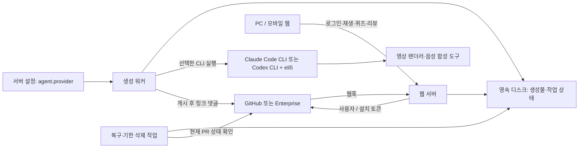
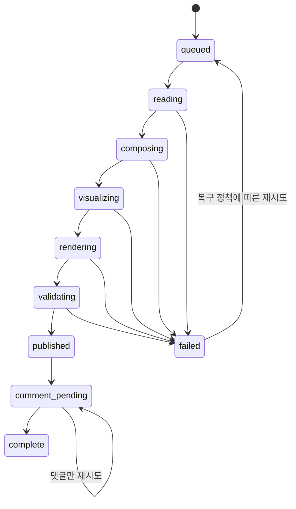
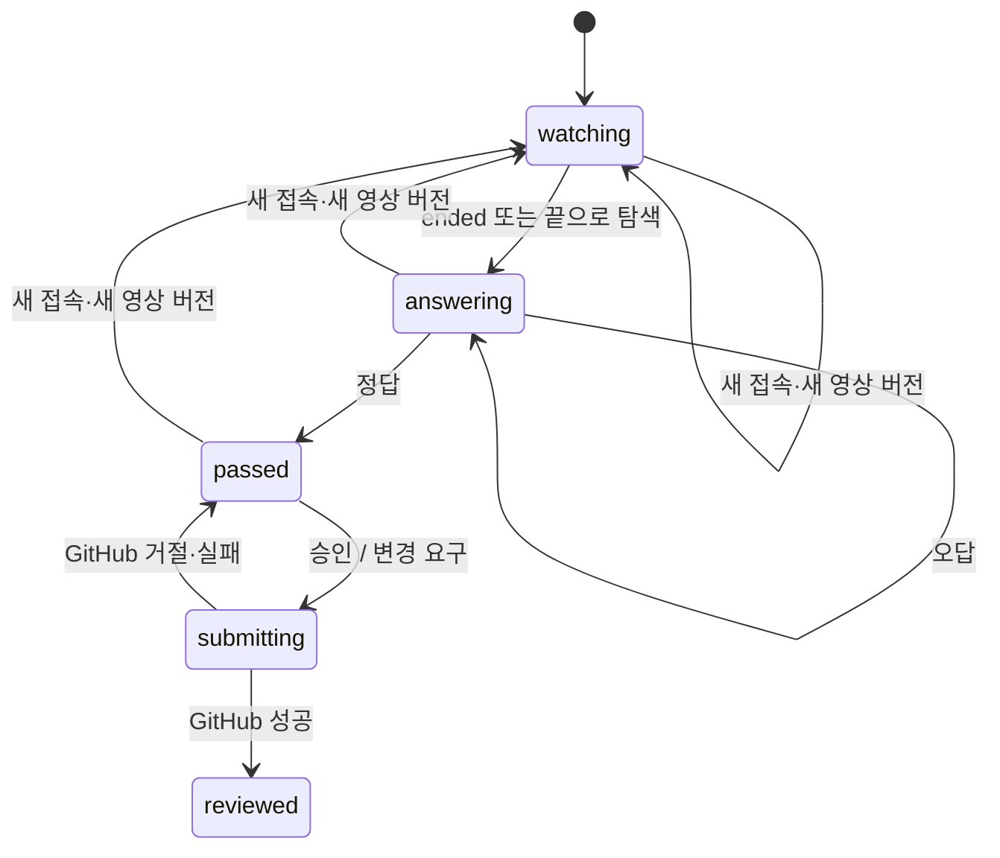

# github-shorts 설계

작성 기준일: 2026-11-08

## 1. 설계 범위와 상태

[Requirement.md](Requirement.md)의 요구사항을 구현하기 위한 초기 설계다. 저장소에는 현재 애플리케이션 구현이 없다. 아래 구성과 API 이름은 구현 제안이며 실행되거나 배포된 기능이 아니다. 요구사항에 없는 운영 정책은 `기본안`으로 표시한다.

초기에는 단일 서버와 영속 디스크를 사용하고 외부 DB·큐 서비스는 도입하지 않는 안을 제안한다. 생성물과 작업 메타데이터를 파일로 관리하고, GitHub를 원본 PR·댓글·리뷰의 기준으로 사용한다. 웹 서버와 생성 워커는 같은 호스트에서 분리된 프로세스로 실행한다. 다중 호스트 운영은 이 파일 잠금 설계의 범위 밖이다.

프런트엔드·서버 언어와 프레임워크는 구현 착수 시 선택한다. 이 문서는 특정 프레임워크에 의존하지 않는 HTTP·파일·GitHub 계약을 정의한다.

## 2. 구성과 책임



| 구성 | 책임 |
| --- | --- |
| 웹 서버 | 로그인, 사용자 권한 확인, 재생목록, 보호된 파일 서빙, 퀴즈 판정, GitHub 작업을 처리한다. |
| 웹훅 수신기 | 원문 서명을 검증하고 작업을 영속 기록한 뒤 빠르게 응답한다. 영상 생성 완료를 기다리지 않는다. |
| 생성 워커 | PR별 작업을 순서대로 실행하고 생성물을 검증한 뒤 새 버전을 게시한다. |
| 선택한 에이전트 CLI | Claude Code CLI 또는 Codex CLI가 PR 분석과 설명·퀴즈·eli5 페이지를 만들고, 음성 합성·렌더링 도구를 실행해 내레이션·자막을 포함한 영상까지 만든다. |
| 영속 디스크 | 생성물, 게시 포인터, 작업 기록, 실패 정보와 삭제 시각을 보관한다. |
| 복구·삭제 작업 | 중단된 생성 작업과 실패한 댓글 게시를 복구하고, GitHub의 종료 상태를 확인해 기한이 지난 정보를 삭제한다. |
| 브라우저 | 화면 조작과 현재 접속의 상태를 표시한다. GitHub 쓰기 권한이나 퀴즈 통과를 자체적으로 확정하지 않는다. |

## 3. GitHub 호스트와 인증

### 3.1. 서버 설정

서버 설정 파일에는 다음 항목을 둔다. 실제 비밀값은 저장소에 커밋하지 않고 서버의 접근 제한된 파일 또는 비밀값 참조로 공급한다.

| 항목 | 의미 |
| --- | --- |
| `public_base_url` | PR 댓글에 넣을 서비스 URL이다. |
| `github_hosts[].id` | 호스트를 구분하는 안정적인 내부 식별자다. |
| `github_hosts[].web_base_url` | GitHub.com 또는 Enterprise의 웹 주소다. |
| `github_hosts[].api_base_url` | 해당 호스트의 REST API 주소다. Enterprise 경로를 GitHub.com과 같다고 가정하지 않는다. |
| `github_hosts[].app_id`, `client_id` | 해당 호스트에 등록된 GitHub App을 식별한다. |
| `github_hosts[].private_key_file`, `client_secret_file`, `webhook_secret_file` | 설치 인증·사용자 인증·웹훅 검증에 필요한 비밀값 파일이다. |
| `github_hosts[].ca_bundle_file` | Enterprise가 사설 CA를 사용하는 경우 검증에 사용하는 인증서다. TLS 검증을 끄는 옵션으로 대신하지 않는다. |
| `data_dir` | 재배포와 재시작 후에도 유지되는 영속 디스크 경로다. |
| `agent.provider` | `claude-code` 또는 `codex`를 선택한다. 기본값은 `claude-code`다. |
| `agent.claude_binary`, `agent.codex_binary` | 각 CLI의 실행 파일 경로다. 선택한 제공자의 실행 파일만 필요하다. |
| `eli5_skill_path` | 선택한 CLI에 제공할 검증된 eli5 스킬 경로다. |

에이전트 설정 형식의 기본안은 다음과 같다. 제품 구현 전의 예시이며 실제 설정 로더가 존재하는 것은 아니다.

```yaml
agent:
  provider: claude-code
  claude_binary: claude
  codex_binary: codex
```

Codex CLI를 사용하려면 `agent.provider`를 `codex`로 지정한다. 지원하지 않는 값이나 선택한 CLI의 실행 파일·인증·필수 도구 누락은 설정 오류로 알리고 작업을 실행하지 않는다. 다른 에이전트로 자동 전환하지 않는 것을 기본안으로 한다. 사용하지 않는 CLI의 설치·인증은 요구하지 않는다.

서버는 설정된 호스트만 사용한다. PR URL이나 브라우저 입력을 이용해 임의 호스트로 요청하지 않는다. 호스트가 여러 개라면 로그인 화면에서 서버에 등록된 이름만 선택할 수 있게 하는 것이 기본안이다.

Enterprise Cloud와 Enterprise Server의 공통 기능은 같은 서버에서 처리하되 호스트별 주소와 App 자격 증명을 분리한다. Enterprise Server에는 해당 인스턴스에 별도로 등록한 App을 사용한다. Cloud의 데이터 레지던시 전용 도메인도 포함해 REST·OAuth 주소를 서버 설정에서 공급하고 GitHub.com 주소를 코드에 고정하지 않는다.

현재 Enterprise Server 버전은 미확인이다. 연결 시 API 응답 또는 웹훅의 `X-GitHub-Enterprise-Version`을 확인하고 필요한 사용자 인증·PR 조회·댓글·리액션·리뷰·웹훅을 실제 검증한다. 헤더를 얻지 못하면 운영자 확인으로 보완하며 임의의 버전을 지원한다고 기록하지 않는다. 검증한 버전과 기능만 지원 표에 남긴다.

### 3.2. 인증 주체의 분리

- 설치 토큰은 App의 저장소 탐색, 생성 입력 조회와 링크 댓글 게시에 사용한다.
- 사용자 토큰은 로그인한 사용자 자신의 댓글·리액션·리뷰와 사용자 권한 확인에 사용한다. 사용자 작업을 봇의 설치 토큰으로 대체하지 않는다.
- 토큰은 브라우저 JavaScript나 생성 웹페이지에 전달하지 않는다. 로그인 쿠키는 HttpOnly·Secure로 설정하고 상태 변경 요청에 CSRF 방어를 적용한다.
- 서버 세션은 초기에는 메모리에 두는 안을 제안한다. 서버 재시작 시 재로그인할 수 있으며, 이를 퀴즈 통과의 영구 보관으로 연결하지 않는다. 만료·갱신은 실제 호스트의 인증 기능을 따른다.

App 권한의 시작점은 Metadata 읽기, Contents 읽기, Pull requests 읽기·쓰기, Issues 읽기다. PR 일반 댓글과 PR 리액션은 해당 엔드포인트가 허용하는 Pull requests 쓰기 권한을 사용하고, 구현 시 호스트별 권한 표로 검증한다. 사용자와 App 권한의 교집합으로 가능한 작업만 노출한다. App 설치가 보이는 것만으로 사용자의 모든 저장소 접근을 허용하지 않는다.

관련 이슈가 App이나 사용자가 접근할 수 없는 저장소에 있다면 내용을 읽은 것으로 꾸미지 않는다. 누락된 근거를 생성 입력과 결과에 명시하고, 핵심 설명에 필수이면 생성 실패로 처리한다.

## 4. 웹훅과 생성 작업

### 4.1. 사건 처리 표

`X-GitHub-Event`, payload의 `action`, 설정된 호스트와 설치 정보를 함께 확인한다. 구체적인 payload는 대상 Enterprise 버전에서도 검증해야 한다.

| 사건 | 처리 |
| --- | --- |
| `pull_request.opened`, `draft=false` | 첫 생성 작업을 등록한다. |
| `pull_request.ready_for_review` | 생성 작업을 등록한다. |
| `pull_request.synchronize`, `edited`, `labeled`, `unlabeled` | 원본 상태를 갱신하거나 무효화하되 생성 작업은 등록하지 않는다. |
| `pull_request.closed` | 즉시 목록에서 제외하고 GitHub의 종료 시각을 기준으로 삭제를 예약한다. 머지도 이 경로로 처리한다. |
| `pull_request.reopened` | 삭제 전이면 삭제 예약을 취소하고 기존 영상을 유지한다. 종료 후 생성물이 삭제된 PR이면 현재 PR을 기준으로 생성 작업을 등록한다. |
| `pull_request.converted_to_draft` | 목록에서 제외한다. 게시된 버전은 종료 삭제 조건과 구분해 보관한다. |
| `pull_request_review` | 리뷰 캐시를 무효화하고 사용자별 목록을 다시 계산한다. |
| 설치 삭제·저장소 접근 변경 | 대상 저장소 목록과 접근 권한 캐시를 무효화한다. 접근 상실 시 생성물 제공을 차단한다. |

App 설치나 대상 저장소 추가 시 기존 PR의 생성 작업을 일괄 등록하지 않는다. 목록 조회·로그인도 생성 트리거로 사용하지 않는다. 기존 PR은 연결 이후 정해진 생성 사건이 발생할 때 처리한다. 서버 복구 시 이미 등록된 작업을 재개하는 것은 기존 PR의 최초 일괄 생성과 구분한다.

생성 작업을 실행하기 직전에 GitHub에서 PR을 다시 읽는다. 현재 닫혔거나 Draft인 PR에는 새 영상을 게시하지 않는 것을 기본안으로 한다. 재생목록의 리뷰 가능 조건과 일치시키기 위한 정책이다.

### 4.2. 영속 작업과 중복 방지

서명은 웹훅의 원문 바이트와 호스트별 비밀값으로 검증한다. 유효한 사건은 `(host_id, delivery_id)`로 중복을 판별하고 `data_dir`에 안전하게 기록한 뒤 성공 응답한다. 기록 실패 시 성공 응답하지 않는다. 같은 delivery가 재전달되어도 새 버전을 두 번 만들지 않는다.

작업 키와 파일 경로에는 호스트 ID, GitHub의 숫자 저장소 ID, PR 번호, 서버가 발급한 작업·버전 ID를 사용한다. `org/repo`는 표시와 GitHub 요청에만 사용해 이름 변경과 경로 탈출을 피한다. 동작은 PR별로 직렬화하고, 각 유효한 생성 사건에는 새 generation ID를 부여한다. 커밋 SHA만으로 중복 제거하면 같은 커밋에 대한 명시적인 재생성 요청을 잃게 되므로 사용하지 않는다.

웹 프로세스는 대기 파일을 만들고 단일 워커가 claim 후 실행한다. 상태는 같은 파일시스템의 임시 파일 쓰기·flush 후 원자적인 rename으로 교체한다. 워커 중복 실행은 OS 파일 잠금으로 막는다. 여러 웹 요청이 같은 PR의 메타데이터를 변경할 때도 같은 잠금을 사용한다. 잠금과 파일 교체의 실제 보장은 배포 디스크에서 검증한다.

### 4.3. 상태 전이



닫힘·Draft 전환·접근 상실을 확인한 작업은 `cancelled`로 끝내고 게시 포인터를 변경하지 않는다. 이전에 게시된 버전이 있으면 새 버전 검증·게시 전까지 유지한다. 실패한 결과를 완성 영상으로 제공하지 않는다. 재시도 횟수·시간 제한은 생성 도구의 실제 실행 시간을 측정해 정하고, 원인과 현재 상태를 운영자가 확인할 수 있게 한다.

## 5. 생성 입력과 결과 계약

### 5.1. 에이전트 선택과 실행

워커는 `agent.provider`에 따라 신뢰된 작업 디렉터리에서 Claude Code의 `-p` 또는 Codex CLI의 `exec`를 실행한다. PR URL, 고정한 입력 버전, 출력 디렉터리와 요구 결과를 전달한다. 프로세스 인자는 문자열 셸 조합이 아닌 인자 배열로 전달하는 구현을 선택한다. 기본값인 Claude Code도 영상 생성까지 직접 처리하며, 에이전트끼리 서로 호출하는 구성은 사용하지 않는다.

공통 생성 계약과 검증 절차를 사용하고 CLI별 차이는 명령 인자, 인증, 스킬 로드와 실행 결과 해석에 한정한다. 작업 등록 시 제공자와 실행 설정을 고정해 같은 작업의 재시도에 사용하고, 실제 CLI·스킬 버전을 생성 메타데이터에 기록하는 것을 기본안으로 한다. 서버 옵션 변경은 이후 등록하는 작업에 적용하며 진행 중인 작업이나 이미 게시된 버전은 바꾸지 않는다.

PR 본문·이슈·코드 안의 문장은 분석 대상 데이터이며 실행 지시가 아니다. 대상 저장소의 훅·설정·스킬을 자동 실행하지 않도록 신뢰된 설정만 로드한다. `eli5`는 배포자가 검토한 스킬 원본과 버전을 고정한다. 각 CLI의 비대화형 실행에서 해당 스킬이 실제 로드되고 사용되는지 사전 검증하며, 무조건적인 권한 우회 옵션을 사용하지 않는다.

사용할 플러그인은 `eli5@claude-community`이며 원본은 `anthropics/claude-plugins-community`의 `eli5/`다. 2026-11-07에 원본 manifest의 버전 `1.0.0`과 `eli5/skills/eli5/SKILL.md`를 확인했다. 이 버전은 원본 저장소에서 확인한 값이며, Codex 앱에 설치된 복사본의 버전을 직접 읽은 결과는 아니다.

이 스킬은 배경지식이 없는 독자에게 큰 시각 자료와 적은 글자로 HTML 설명을 만드는 지침을 제공한다. 확인한 스킬 지침에는 PR 분석, 사지선다 퀴즈, 영상·음성 생성 규칙이 없다. 선택한 에이전트가 설명과 퀴즈 계약을 준비해 스킬에 함께 전달하고, 결과 HTML을 파일로 저장한다. 같은 에이전트가 렌더러와 음성 합성 도구를 실행해 영상을 만든다.

Codex 앱에서 활성화된 사실만으로 서비스 워커의 CLI에도 배포되었다고 간주하지 않는다. 서버에 검토한 스킬을 별도로 배포하고 버전·커밋을 고정한 뒤, 각 CLI가 지원하는 로드 방식으로 지침을 제공한다. Claude Code의 `-p`와 Codex의 `exec`에서 각각 스킬 적용과 결과 파일 생성을 확인한다. 두 CLI가 같은 플러그인 설정 형식을 사용한다고 가정하지 않는다. 현재까지 CLI를 통한 전체 생성 흐름은 검증하지 않았다.

분석 과정에 필요한 GitHub 읽기 권한만 생성 프로세스에 제공한다. 리뷰 쓰기, 서버 설정 읽기와 다른 PR의 파일 읽기 권한을 생성 도구에 넘기지 않는다. 생성 도구는 작업 디렉터리에 결과를 쓰고, PR 댓글 게시와 사용자 리뷰 제출은 서버가 담당한다.

### 5.2. 입력 스냅샷

작업 시작 시 원본 PR, 관련 이슈와 diff를 읽고 `source_head_sha`, base 정보, PR 제목·본문과 참조 이슈의 입력 해시를 기록한다. `source_fingerprint`는 이 생성이 무엇을 설명했는지 추적하기 위한 값이며, 해시 변화 자체를 자동 재생성 트리거로 사용하지 않는다.

생성 중 원본이 변경되면 최신 내용을 설명한 것으로 표시하지 않는다. 게시 전 다시 비교한다. 입력이 바뀐 결과는 게시하지 않고 이전 버전을 유지하며 명시적인 생성 트리거를 기다리는 것을 기본안으로 한다. 이전 영상과 현재 코드가 다르면 QUIZ-05에 따라 서비스 내 리뷰 제출을 차단한다.

### 5.3. 설명과 퀴즈

설명·퀴즈 계약의 필수 필드는 다음과 같다.

| 필드 | 제약 |
| --- | --- |
| `summary`, `scenes` | PR 목적, 변경 전후와 근거를 포함한다. 실제 검증하지 않은 효과를 확정 사실로 표현하지 않는다. |
| `quiz.question` | 문제는 하나다. |
| `quiz.choices` | 안정적인 ID를 가진 보기 네 개다. |
| `quiz.correct_choice_id` | 네 보기 중 정확히 하나를 가리킨다. |
| `quiz.explanation` | 정답의 이유를 설명한다. |
| `source_references` | 설명의 근거가 되는 PR·이슈·파일을 가리킨다. |

이 계약을 먼저 만든 뒤 `eli5`에 설명과 퀴즈를 함께 전달한다. 시각화 웹페이지 마지막에 문제·네 보기와 접을 수 있는 정답·해설을 넣는다. 렌더러도 같은 계약을 입력으로 사용한다. 웹페이지·영상·퀴즈 UI가 각자 문제를 새로 만들지 않게 한다.

### 5.4. 영상 생성과 미디어 규격

선택한 에이전트는 같은 작업 ID·생성 버전의 설명·장면·퀴즈 계약, 시각화 HTML과 시각 자료를 사용해 영상을 만든다. 영상 단계에서 퀴즈를 새로 만들지 않고 웹페이지와 같은 문제·보기를 사용한다.

에이전트는 한국어 내레이션 합성, 자막 타이밍 구성과 영상 렌더링을 수행하고 영상·음성·자막·렌더 manifest를 작업 디렉터리에 저장한다. 각 CLI는 서버 내부의 음성 합성·렌더링 도구를 실행한다. 외부 TTS API는 사용하지 않으며 로컬 합성 실패 시에도 외부 TTS로 전환하지 않는다. 구체적인 TTS 모델·도구와 선택한 CLI의 서버 인증·실행 권한은 배포 시 검증한다.

에이전트에는 신뢰된 설정과 해당 작업의 파일·도구 접근 권한만 제공한다. 미디어 도구에 GitHub 토큰을 그대로 상속하지 않고 필요한 권한만 별도로 공급한다. 종료 코드나 완료 메시지만으로 성공 처리하지 않고 워커가 실제 결과 파일을 검증한다. 에이전트 실패·시간 초과·취소 시 미완성 결과를 게시하지 않으며, PR 종료나 작업 취소 시 선택한 CLI와 하위 미디어 프로세스도 함께 중단한다.

인코딩 기본안은 MP4, H.264, AAC, 1080×1920, 9:16이다. 이는 샘플과 모바일 호환성을 참고한 제안이며, 프레임레이트·비트레이트·음성 생성 도구는 구현 시 고정한다. 웹 재생을 위해 초기 재생에 필요한 메타데이터를 파일 앞쪽에 배치한다.

한국어 내레이션과 자막을 함께 생성한다. 장면별 대본을 기준으로 서버 내부에서 음성을 합성하고, 실제 합성 음성의 길이에 맞춰 장면과 자막의 시작·종료 시점을 배치한다. 대본·합성 음성·자막 타이밍도 같은 생성 버전의 결과물로 보관하고 PR 종료 후 같은 기한에 삭제한다. 모델과 실행에 필요한 파일을 사전에 배포해 실제 합성에 외부 TTS 통신이 필요하지 않게 한다. 샘플의 macOS 음성을 운영 서버용 도구로 확정한 것은 아니다.

실제 내레이션과 마지막 퀴즈가 30~60초 안에 들어가도록 대본과 장면 길이를 조정한다. 대본 글자 수만으로 영상 길이나 자막 동기화를 검증하지 않는다. 자막을 영상에 합성할지 별도 트랙으로 제공할지는 렌더러 구현에서 결정하되, 기본 재생 화면에서 음소거 상태로도 읽을 수 있게 한다.

렌더 결과에 대해 다음을 검사한다.

- 실제 파일의 총길이가 30~60초이고, 마지막 퀴즈 구간의 길이가 0초 초과·10초 이내인지 확인한다.
- 마지막 구간에 같은 문제와 네 보기가 읽을 수 있게 표시되는지 확인한다.
- 컨테이너, 코덱, 해상도, 오디오와 파일 손상을 검사한다. 장면 manifest만 보고 실제 영상을 검증했다고 간주하지 않는다.
- 한국어 음성의 발음·누락, 자막과 대본의 일치, 음성·자막·장면의 타이밍을 실제 재생으로 확인한다.
- iPhone Safari와 PC 브라우저에서 글자 크기, 자막·컨트롤 겹침과 음성 재생을 확인한다.

선택한 에이전트가 사용할 렌더러와 서버 내부 TTS 모델·도구는 아직 선택하지 않았다. 기능 검증 전 생성 시간·비용이나 대량 처리량을 보장하지 않는다.

## 6. 생성물과 로컬 데이터

디렉터리 구조의 기본안은 다음과 같다. API 키와 사용자 토큰은 이 트리에 저장하지 않는다.

```text
data/
  hosts/{host_id}/repos/{repository_id}/pulls/{pr_number}/
    manifest.json
    jobs/{job_id}.json
    versions/{generation_id}/
      content.json
      explanation.html
      video.mp4
      poster.webp
      render-manifest.json
    work/{job_id}/
  inbox/{host_id}/{delivery_id}.json
```

`manifest.json`에는 활성 버전, 작업 상태, 종료·삭제 예정 시각과 게시 댓글 ID를 기록한다. 각 버전은 생성 ID, 생성 원인, 사용한 에이전트·CLI·스킬 버전, 참조 커밋·입력 해시, 게시 시각, 검증 결과와 파일 경로를 갖는다. 게시 포인터를 교체하기 전에 모든 파일 검증을 마친다.

원본 정보는 GitHub가 기준이다. 메타데이터의 PR 상태나 리뷰 목록은 조회 비용을 줄이는 캐시이며 GitHub 쓰기 성공 없이 변경하지 않는다. 필요한 입력 스냅샷과 작업 로그도 해당 PR의 보관 기한을 따른다. 댓글이나 파일 내용에 토큰·비밀값을 기록하지 않는다.

## 7. 게시와 PR 댓글

새 버전은 전체 파일을 준비한 후 PR별 잠금 아래 활성 포인터와 `published_at`을 한 번에 바꿔 게시한다. 새 버전이 게시되면 목록 정렬과 퀴즈 버전이 함께 변경된다. 댓글은 설치 토큰으로 게시하고 서비스의 안정적인 PR 페이지 URL을 포함한다. URL에는 설정된 호스트 ID와 저장소 ID로 원본 PR을 구분할 수 있어야 한다.

기본안은 서비스 봇의 링크 댓글 하나를 갱신하는 것이다. 댓글 본문에 고유한 서비스 마커를 두고, 타임아웃 후 재시도할 때 기존 봇 댓글을 확인해 중복을 방지한다. 사용자 댓글을 마커만 보고 수정하지 않고 작성자도 검증한다. 영상 게시 후 댓글 실패는 영상을 다시 생성하지 않고 `comment_pending`으로 복구한다.

## 8. 재생목록과 리뷰 버전

### 8.1. 조회 순서

1. 로그인 사용자에게 접근 가능한 App 대상 저장소를 조회한다.
2. 브라우저가 선택한 저장소 ID와 교집합을 구한다. 첫 접속에서는 전체를 선택한다.
3. 현재 open이며 Draft가 아닌 PR과 활성 영상 버전을 결합한다. 검증·게시가 완료되고 재생 가능한 영상 파일이 있는 항목만 남긴다.
4. 현재 버전에 대해 사용자가 제출한 정식 리뷰가 있는지 확인하고 제외한다.
5. `published_at` 내림차순으로 정렬한다. 시각이 같으면 호스트 ID·저장소 ID·PR 번호로 순서를 고정한다.

GitHub API의 페이지를 끝까지 조회해 페이지 기본 개수 때문에 PR이나 리뷰가 누락되지 않도록 한다. 원본 갱신에는 웹훅과 짧은 조회 캐시를 사용하고, 서버 복구 시 현재 상태를 다시 확인한다. 조회 실패를 빈 목록이나 접근 허용으로 처리하지 않는다.

### 8.2. 외부 리뷰를 버전에 연결하는 기본안

서비스에서 제출한 리뷰는 서버 작업 기록에 `(generation_id, user_id, github_review_id)`를 연결한다. 외부 GitHub 리뷰에는 서비스의 영상 ID가 없으므로 리뷰의 사용자와 `submitted_at`을 현재 영상의 `published_at`과 비교한다. 초 단위 경계에서는 게시 직전에 수집한 제출 완료 리뷰 ID 집합을 함께 사용해 이미 있던 리뷰와 구분한다. 시계는 UTC로 동기화하고 PR별 게시와 리뷰 제출을 직렬화한다.

현재 게시 후 제출된 `APPROVED`, `CHANGES_REQUESTED`, `COMMENTED` 리뷰는 목록 제외에 반영한다. `PENDING`은 제출되지 않았으므로 반영하지 않는다. 일반 issue comment도 반영하지 않는다. 제출된 리뷰가 나중에 dismiss되어도 현재 영상 버전에 대한 ‘리뷰를 남겼다’는 이력을 유지한다. 리뷰 상태가 바뀌었다는 이유로 이 연결을 삭제하지 않는다. GitHub에서 이미 무효화된 리뷰를 처음 수집하는 경우에도 원본의 제출 이력과 영상 버전 기준으로 판정한다. 외부 리뷰는 영상 시청 여부를 입증하지 않는다.

이 방식에서 새 영상 게시 전의 리뷰는 새 버전을 제외하지 않는다. 코드 변경만으로 기존 영상 버전과 리뷰 판정을 초기화하지 않는다. 같은 커밋에서 재생성할 수 있으므로 `commit_id` 일치만으로 버전을 결정하지 않는다.

### 8.3. 영상이 없는 대상 PR

기존 PR은 최초 연결 시 일괄 생성하지 않는다. 따라서 생성 트리거가 없어 작업이 등록되지 않은 ‘미생성’ 상태를 작업이 등록된 뒤의 ‘대기·진행·실패’와 구분한다. 미생성 PR을 발견했다는 이유로 자동 생성하지 않는다.

재생목록에는 재생 가능한 게시 영상만 포함하고 미생성·대기·진행·실패 상태 카드를 넣지 않는다. 영상이 없는 PR에 임의의 게시 시각을 부여하지 않는다. 상태는 내부 작업 복구에 사용하고, 별도의 사용자용 상태 목록은 필수 기능으로 추가하지 않는다.

재생 가능 여부는 현재 활성 버전을 기준으로 확인한다. 새 버전 생성이 진행 중이거나 실패해도 기존 활성 영상이 유효하면 그 영상과 리뷰 여부로 목록 포함 여부를 판단한다.

## 9. 접속·퀴즈·리뷰

로그인 세션과 퀴즈 접속 세션을 분리한다. 페이지를 새로 열거나 새로고침하면 서버에서 새 `view_session_id`를 발급한다. 브라우저의 localStorage·영구 쿠키에 퀴즈 통과 여부를 저장하지 않는다. 다른 탭·기기는 별도 접속으로 취급한다.

같은 페이지 안에서 다른 PR로 이동했다 돌아오면 유효한 접속에서 같은 버전에 대한 통과를 유지한다. 페이지가 재생성되거나 새 버전이 게시되면 다시 풀어야 한다. 세션은 사용자 ID와 연결하고 서버 만료 시 재시도를 안내한다. 통과를 유지하더라도 코드 일치·PR 상태·작성자·권한 등 리뷰 제출 조건은 매번 다시 검사한다.



영상 끝의 퀴즈는 화면에 문제와 보기를 보여주는 구간이고, 선택 버튼은 재생 종료 후 노출한다. 끝으로 건너뛰기를 허용하므로 실제 시청 시간을 수집해 자격 조건으로 쓰지 않는다. 영상 종료 알림과 정답 응답은 서버의 접속·버전 상태에 반영한다. 정답과 해설은 웹페이지에서도 공개되므로 이 기능을 부정행위 방지나 학습 성과 인증으로 설명하지 않는다.

리뷰 제출 시 서버는 다음을 다시 검증한다.

1. 로그인 사용자와 접속 세션, 저장소 접근 권한이 유효한지 확인한다.
2. 요청한 영상이 현재 활성 버전이고 해당 접속에서 퀴즈를 통과했는지 확인한다.
3. PR이 현재 open이며 Draft가 아니고 사용자가 PR 작성자가 아닌지 확인한다.
4. 변경 요구이면 공백이 아닌 의견이 있는지 확인한다.
5. 영상의 참조 커밋·코드 diff와 현재 PR의 코드를 비교한다. 코드가 다르면 퀴즈 통과 여부와 무관하게 `409`로 제출을 차단한다. 현재 코드를 반영한 새 영상 게시와 해당 영상의 퀴즈 통과가 모두 필요하다.
6. 사용자 토큰으로 `APPROVE` 또는 `REQUEST_CHANGES`를 제출한다. 대상 `commit_id`는 명시해 잘못된 커밋을 기본값으로 리뷰하지 않게 한다.
7. 성공한 GitHub 리뷰 ID를 기록하고 목록에서 제거한다.

중복 클릭은 요청 ID와 PR별 잠금으로 한 번만 처리한다. GitHub가 요청을 받았는지 불명확한 타임아웃은 사용자·요청 표식·대상 커밋의 리뷰를 조회해 결과를 확인한 뒤 재시도한다. 외부 API와 로컬 기록 사이에 원자적인 트랜잭션이 있다고 가정하지 않는다.

일반 댓글·리액션·공유·원본 열기는 퀴즈 통과와 무관하게 사용할 수 있다. 본인 PR에서는 정답 후에도 리뷰 버튼을 제공하지 않고 서버도 제출을 거절한다.

현재 영상과 코드의 불일치는 코드 변경 웹훅 또는 원본 재조회 시 화면에 전달한다. 이미 리뷰 입력을 시작했더라도 제출 직전에 다시 확인하고, 불일치이면 의견을 보존한 채 새 영상이 필요하다고 안내한다. 이 검사는 코드 변경을 자동 재생성 트리거로 추가하지 않는다. PR 작성자가 Draft로 전환했다가 해제해 재생성할 수 있다.

## 10. HTTP 계약 초안

다음 경로는 애플리케이션 내부 API 제안이다. 구현된 엔드포인트가 아니다. `prKey`는 서버가 발급한 호스트·저장소·PR 식별자이고, `version`은 활성 버전과 대조한다.

| 경로 | 역할과 주요 검증 |
| --- | --- |
| `GET /auth/{host}/login`, `GET /auth/{host}/callback` | 서버 설정의 호스트로 로그인하고 OAuth state를 검증한다. |
| `POST /webhooks/{host}` | 원문 서명과 설치를 검증하고 영속 작업을 등록한다. |
| `GET /api/repos` | 현재 사용자에게 허용된 대상 저장소를 반환한다. |
| `POST /api/view-sessions` | 로그인 세션 아래 새 퀴즈 접속을 만든다. |
| `GET /api/feed` | 선택 저장소와 페이지 커서를 기준으로 재생 가능한 게시 영상만 정렬해 반환한다. |
| `GET /p/{prKey}` | PR의 안정적인 서비스 페이지를 연다. 직접 열기도 권한·상태를 검사한다. |
| `GET /api/prs/{prKey}/versions/{version}/video` | 사용자 권한을 검사하고 Range 요청을 지원해 영상을 제공한다. |
| `GET /api/prs/{prKey}/versions/{version}/explanation` | 권한 검사 후 격리된 시각화 웹페이지를 제공한다. |
| `POST /api/prs/{prKey}/quiz/start` | 해당 접속·버전에서 영상 종료를 처리하고 보기 네 개를 반환한다. |
| `POST /api/prs/{prKey}/quiz/answer` | 접속·버전·보기 ID를 검증하고 정오답·통과 상태를 반환한다. |
| `GET/POST /api/prs/{prKey}/comments` | 일반 PR 댓글을 조회하거나 사용자 이름으로 작성한다. |
| `GET/POST/DELETE /api/prs/{prKey}/reactions` | PR 자체의 리액션을 조회·추가하거나 자신의 리액션을 제거한다. |
| `POST /api/prs/{prKey}/reviews` | 퀴즈·버전·권한·의견·중복을 검증한 뒤 정식 리뷰를 제출한다. |

버전 교체 충돌은 `409`, 세션·권한 문제는 `401/403`, 검증 오류는 `422` 등으로 구분한다. 미디어 요청에서 허용되지 않은 리소스의 존재를 노출하지 않도록 응답 정책을 통일한다. 삭제 후 오래된 서비스 링크는 로그인·GitHub 상태 확인을 거쳐 생성물이 만료되었다는 화면을 표시하는 기본안이다.

## 11. 파일 제공과 브라우저 보안

비공개 영상을 인증 없는 정적 공개 디렉터리에 두지 않는다. 서버는 미디어·포스터·설명·퀴즈 접근 모두에서 사용자의 저장소 접근 권한을 검사한다. 리버스 프록시로 파일을 전송하더라도 인증 후 내부 경로로 넘긴다. Range 응답에서도 인증을 생략하지 않고 사용자별 응답이 공유 캐시에 저장되지 않게 한다.

생성 HTML은 신뢰되지 않는 결과로 취급한다. 설명 페이지는 쿠키·토큰이 전달되지 않는 별도 출처 또는 `allow-same-origin`을 제외한 sandbox iframe에 표시한다. 필요한 스크립트만 허용하고 상위 화면 이동, 외부 네트워크 접근과 임의 리소스 로딩을 제한한다. 페이지에서 API 권한을 얻을 수 없게 한다. 서버가 제어하는 바깥 화면에서 설명 링크와 닫기를 제공한다.

모바일은 `playsinline`과 사용자의 재생 동작을 지원한다. 자동 재생·소리 재생은 브라우저 정책에 따라 거절될 수 있으므로 재생 버튼을 항상 제공한다. 한 번에 활성 영상 하나만 재생하고 화면 이동 시 이전 영상을 멈춘다. 자막과 안전 영역을 포함한 실제 기기 검증은 별도 수행한다.

## 12. 종료·삭제·복구

`delete_after = closed_at + 24h`로 계산하며, merge이면 `merged_at`도 확인한다. 웹훅 수신 시각을 기한의 시작으로 삼지 않는다. 종료 시 즉시 목록에서 제외하고 진행 중 작업을 취소한다. 종료 후 삭제 기한까지는 저장소 접근 권한이 있는 로그인 사용자가 직접 링크로 기존 영상을 볼 수 있게 하고 삭제 예정 시각을 표시한다. 종료된 PR의 리뷰 제출은 화면과 서버 모두 차단한다. 삭제 작업이 지연되어 파일이 남아 있더라도 기한이 지난 영상은 제공하지 않는다.

삭제 직전 GitHub의 현재 상태와 종료 시각을 다시 읽는다. API 실패 시 열린 PR이라고 가정하지도, 삭제해도 된다고 가정하지도 않는다. 삭제를 보류하고 재시도하며 운영 경고를 남긴다. 이 경우 24시간 기한을 넘길 수 있으므로 지연을 감지해야 한다.

생성물 삭제 전에 다시 열리면 삭제 예약을 취소하고 기존 영상을 사용한다. 이전 리뷰 이력을 초기화하지 않고, 코드가 다르면 QUIZ-05의 차단을 유지한다. 이후 다시 닫히면 새 종료 시각으로 기한을 계산한다. 이미 생성물이 삭제된 PR이 다시 열리면 현재 PR을 기준으로 생성 작업을 등록한다. 새 영상 게시 후에는 새 버전의 퀴즈·리뷰 기준을 적용한다.

재오픈 처리와 삭제 작업은 같은 PR 잠금을 사용하고 GitHub의 현재 상태를 다시 확인한다. 삭제 후에는 로컬 메타데이터도 없어지므로, 파일이 없다는 이유만으로 과거 삭제가 있었다고 단정하지 않는다. GitHub에 남은 서비스 게시 댓글과 PR 종료·재오픈 이력으로 이전 생성과 종료 기간을 확인하는 것을 기본안으로 한다. 원본 조회가 실패하거나 이력을 확인할 수 없으면 복구를 보류하고 재시도한다. 처음부터 생성되지 않은 기존 PR의 처리는 OPEN-03과 구분한다.

삭제는 PR별 잠금 아래 모든 버전·설명·퀴즈·작업 디렉터리·메타데이터·캐시·연관 inbox 기록에 적용한다. 생성 프로세스를 먼저 중단하고 활성 파일 전송과의 경합을 정리한 뒤 삭제한다. 같은 파일의 다른 복사본이나 백업이 기한을 우회하지 않게 한다. 로그에 생성 본문을 남기지 않고 PR별 상세 로그도 같은 기한으로 정리한다. GitHub의 사용자 댓글·리뷰는 삭제하지 않는다.

GitHub는 실패한 웹훅을 자동 재전송하지 않으므로, 복구 작업은 최근 전달 실패를 확인하고 현재 열린·종료 PR 상태와 로컬 작업을 대조한다. 단순 상태 대조가 유실된 동일 커밋 재생성 사건까지 재구성한다고 주장하지 않는다. 상태 복구와 사건 재전달을 별도로 처리한다. 전달 기록의 조회 기간과 지원 API는 배포 호스트에서 검증한다.

## 13. 화면 계약

[UI-Figma.md](UI-Figma.md)의 화면 ID와 상태를 사용한다. 핵심 연결은 영상 화면 → 재생 종료 → 네 보기 → 정오답 → 리뷰 입력 → GitHub 성공이다. 댓글 패널과 리액션 선택기는 이 경로와 독립적으로 사용할 수 있다.

전체 필터 해제, 접근 가능한 저장소 없음, 리뷰할 PR 없음, 영상 생성 중·실패, 권한 상실, 새 영상 게시, 세션 만료, PR 종료·생성물 삭제를 서로 다른 상태로 표시한다. GitHub 조회 오류를 ‘모두 리뷰했어요’로 바꾸지 않는다.

## 14. 구현·검증 순서

1. 실제 GitHub.com·대상 Enterprise에서 로그인, 사용자 권한과 App 권한을 확인한다.
2. 세 생성 사건, 삭제 전 재오픈과 라벨 변경으로 생성되지 않는 조건, 중복 전달, 실패 후 복구와 PR 종료 기한을 검증한다.
3. 옵션 생략·`claude-code`·`codex`를 각각 확인하고, 두 CLI에서 고정 입력의 설명·퀴즈 계약과 `eli5` 적용을 검증한다. 잘못된 설정은 오류를 알리고 실행하지 않으며 사용하지 않는 CLI가 없어도 선택한 에이전트가 동작하는지 확인한다.
4. 각 CLI가 분석부터 실제 영상 생성까지 처리하는 흐름을 확인하고, 외부 TTS 통신 없이 서버 내부에서 한국어 음성을 합성하는지 검증한다. 내레이션·자막·길이·마지막 퀴즈·iPhone 재생을 확인한다. 에이전트 실패·시간 초과 시 게시되지 않고 취소 시 하위 미디어 프로세스도 중단되는지 확인한다.
5. 사용자별 목록과 외부 리뷰 반영, 동일 커밋 재생성·영상 교체를 검증한다.
6. 건너뛰기, 오답 반복, 재접속 초기화와 서버 리뷰 차단을 검증한다.
7. 실제 댓글·리액션·승인·변경 요구를 테스트 저장소에서 확인한다.
8. 종료·재오픈·삭제·작업 경합과 권한 상실을 검증한다.

검증 항목은 Requirement.md의 AC-01~AC-22에 연결한다. 퀴즈 통과 후 코드 변경과 리뷰 제출 사이의 경합은 AC-15로, 재오픈과 삭제의 경합은 AC-16으로, 기존 PR을 일괄 생성하지 않는 정책은 AC-17로, 재생 가능한 영상만 목록에 포함하는 정책은 AC-18로, 에이전트 선택과 설정 변경 시 기존 버전 유지는 AC-19로 확인한다. 서버 내부 TTS는 AC-20, 리뷰 무효화 후 목록 제외 유지는 AC-21, 같은 페이지에서 퀴즈 통과 유지는 AC-22, 종료 후 직접 링크 열람과 기한 만료는 AC-12로 확인한다. 문서·화면 시안 검토와 실제 API·영상 생성·기기 검증은 구분한다.

## 15. 기술 근거와 확인할 의존성

- [GitHub 웹훅 사건](https://docs.github.com/en/webhooks/webhook-events-and-payloads)과 Octokit의 [opened](https://github.com/octokit/webhooks/blob/main/payload-schemas/api.github.com/pull_request/opened.schema.json), [ready_for_review](https://github.com/octokit/webhooks/blob/main/payload-schemas/api.github.com/pull_request/ready_for_review.schema.json), [unlabeled](https://github.com/octokit/webhooks/blob/main/payload-schemas/api.github.com/pull_request/unlabeled.schema.json) 스키마를 사건·action 매핑의 기준으로 사용한다. 대상 호스트에서 실제 payload를 확인한다.
- [웹훅 처리 지침](https://docs.github.com/en/webhooks/using-webhooks/best-practices-for-using-webhooks), [실패한 전달 처리](https://docs.github.com/en/webhooks/using-webhooks/handling-failed-webhook-deliveries): 빠른 응답·전달 ID·복구의 근거다.
- [GitHub Review API](https://docs.github.com/en/rest/pulls/reviews): 리뷰 상태·사용자·제출 시각·대상 커밋과 제출 필드의 기준이다.
- [GitHub App 사용자 토큰](https://docs.github.com/en/apps/creating-github-apps/authenticating-with-a-github-app/generating-a-user-access-token-for-a-github-app): 사용자 이름으로 수행하는 작업의 인증 기준이다.
- [Enterprise Server용 GitHub App 지원](https://docs.github.com/en/enterprise-cloud%40latest/apps/sharing-github-apps/making-your-github-app-available-for-github-enterprise-server): 인스턴스별 App 등록, 주소 분리와 버전별 기능 확인의 기준이다.
- [PR 댓글 API](https://docs.github.com/en/rest/issues/comments), [리액션 API](https://docs.github.com/en/rest/reactions/reactions): 사용자 댓글과 PR 리액션에 사용한다.
- [Claude Code 비대화형 실행](https://code.claude.com/docs/en/headless): `-p` 실행과 신뢰할 설정·스킬 로딩을 확인하는 기준이다.
- [Codex 비대화형 실행](https://learn.chatgpt.com/docs/non-interactive-mode): `codex exec` 호출과 자동화 환경의 실행 권한·인증을 확인하는 기준이다.
- [eli5 원본 manifest](https://github.com/anthropics/claude-plugins-community/blob/main/eli5/.claude-plugin/plugin.json), [eli5 스킬 지침](https://github.com/anthropics/claude-plugins-community/blob/main/eli5/skills/eli5/SKILL.md): 플러그인 식별자·원본 버전과 HTML 설명 생성 지침을 확인했다.

`eli5` 원본과 원본 manifest의 버전은 확인했다. 서버 옵션으로 Claude Code CLI 또는 Codex CLI를 선택하고, 선택한 에이전트가 영상까지 생성하는 구조는 확정됐다. 기본값은 Claude Code다. TTS는 외부 API 없이 서버 내부에서 실행한다. OPEN-04에서 남은 사항은 각 CLI 환경의 스킬 배포본·로드 검증, 인증과 실행 권한, 렌더러·서버 내부 TTS 모델·도구, Enterprise 지원 버전과 실제 App 설정이다. OPEN-01~03의 제품 정책과 리뷰 무효화·페이지 내 퀴즈 통과·종료 후 직접 링크 정책은 확정됐으며 이 문서와 Requirement.md 본문에 반영했다.
